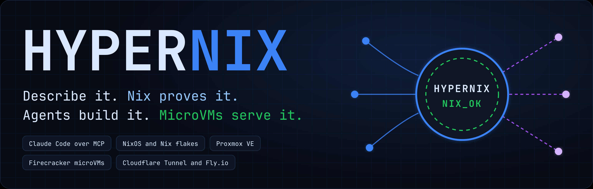
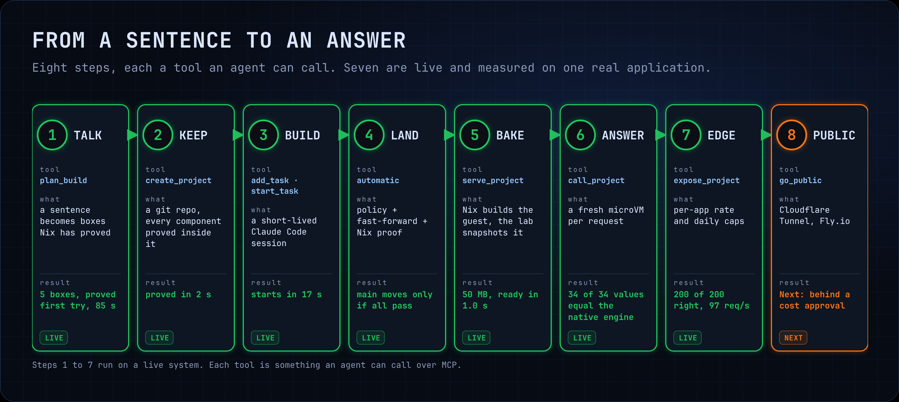
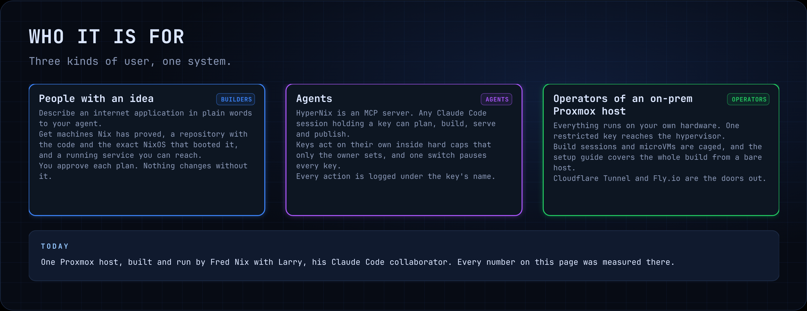
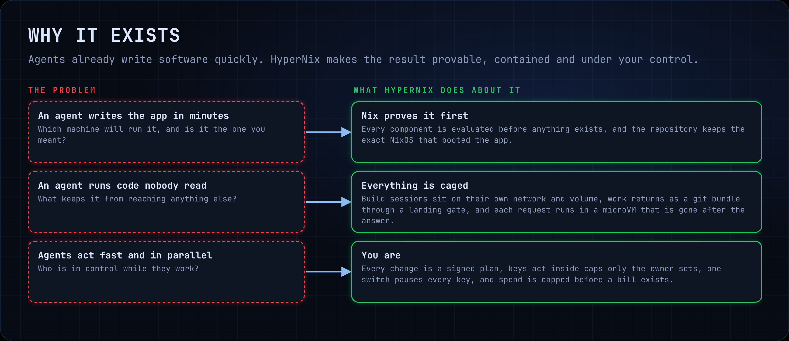
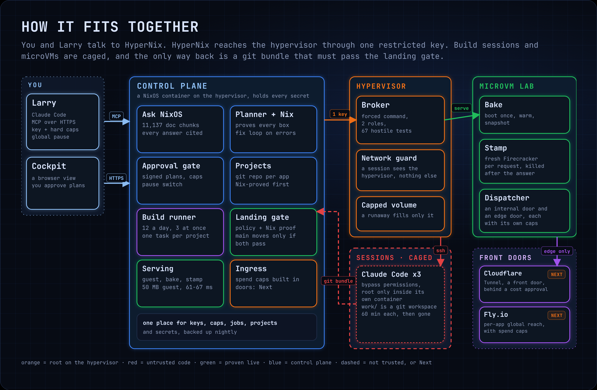
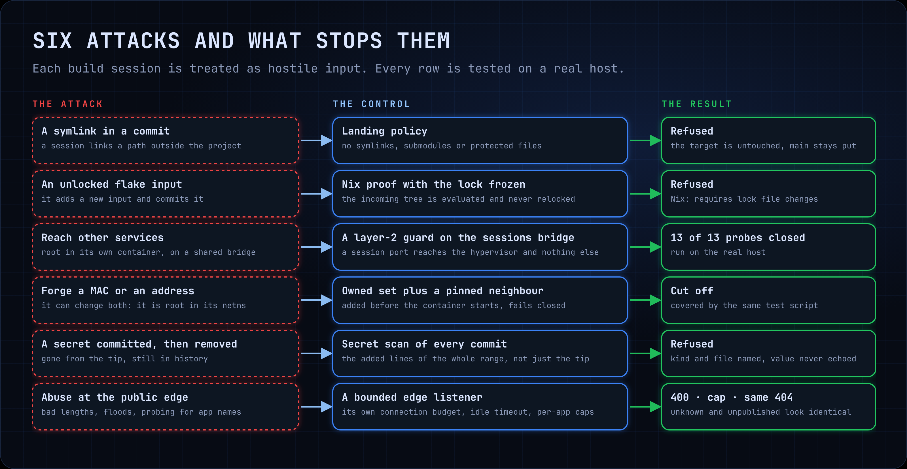
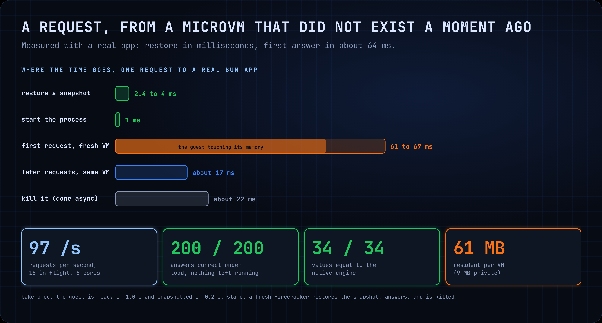
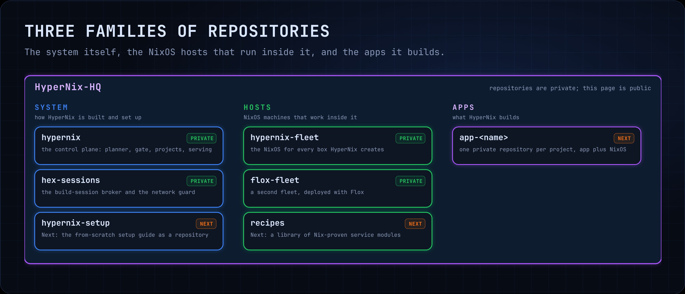

# HyperNix

**HyperNix turns a description of an internet application, in plain words, into running software.**

An agent designs the application with you. Nix proves the machines before anything is created. Short-lived Claude Code sessions build it in a persistent workspace. The git repository keeps the app and the exact NixOS that booted it. Every request is answered by a Firecracker microVM that is gone after the answer.

This organization is where HyperNix lives: the system itself, the NixOS hosts that run inside it, and the apps it builds.

- [What it does](#what-it-does)
- [Who it is for](#who-it-is-for)
- [Why it exists](#why-it-exists)
- [How it fits together](#how-it-fits-together)
- [How it stays safe](#how-it-stays-safe)
- [How fast it is](#how-fast-it-is)
- [What is in this organization](#what-is-in-this-organization)
- [Built on](#built-on)
- [Next](#next)
- [Who builds it](#who-builds-it)

---

## What it does

You describe an application to your agent. HyperNix is the machinery behind that sentence, and every step is a tool the agent can call over MCP.

1. **Talk.** A sentence becomes a plan: which machines, how many, how big, with their secrets named and never shown. Nix evaluates every component of the plan before it is offered for approval. A five-machine plan was proved on the first try in 85 seconds.
2. **Keep.** A project is a git repository holding the app, its tests and a locked flake with the NixOS for every component. It is created only if Nix proves every component inside the new repository (2 seconds for one real project).
3. **Build.** Short-lived Claude Code sessions, up to three at a time, each take one task in the project's persistent workspace, commit, and end. A session starts in 17 seconds and lasts at most 60 minutes.
4. **Land.** A session's work comes back as a git bundle and is treated as hostile input. It moves `main` only if it passes the landing gate: policy, a secret scan of every commit, and a Nix proof of the incoming tree.
5. **Bake.** Nix builds a 50 MB guest image for the app, boots it once, lets it warm up, and snapshots it. The guest is ready in 1.0 second.
6. **Answer.** Each request is served by a fresh Firecracker microVM restored from that snapshot, then killed. Across 34 test values the answers equal the native engine's.
7. **Edge.** A public-facing listener answers only apps that were published, with a per-app rate limit and daily cap. A request for an unpublished app looks identical to a request for an app that never existed. Under load it gave 200 correct answers out of 200 at 97 requests per second.
8. **Public.** Cloudflare Tunnel and Fly.io as the doors to the internet, each behind a cost approval. See [Next](#next).

**It also reads the documentation.** HyperNix keeps an index of 11,137 chunks from the NixOS manual, the Nix manual, nix.dev, the flakes book, the Nixpkgs manual, home-manager, srvos, disko, nixos-anywhere, flake-parts, sops-nix, microvm.nix, the Proxmox docs, Flox and Fly.io. Every answer cites its source, and every GitHub source is pinned to the commit it was read at.

---

## Who it is for

- **People with an idea.** You describe an internet application in plain words to your agent. You get machines Nix has proved, a repository with the code and the exact NixOS that booted it, and a running service you can reach. You approve each plan, and nothing changes without it.
- **Agents.** HyperNix is an MCP server. Any Claude Code session holding a key can plan, build, serve and publish. Keys act on their own inside hard caps that only the owner sets, and one switch pauses every key. Every action is logged under the key's name.
- **Operators of an on-prem Proxmox host.** Everything runs on your own hardware. One restricted key reaches the hypervisor. Build sessions and microVMs are caged. The setup guide covers the whole build from a bare host.

**Today:** HyperNix runs on one Proxmox host, built and operated by Fred Nix with Larry, his Claude Code collaborator. Every number on this page was measured there in November 2026.

---

## Why it exists

Agents already write software quickly. The slow part is trusting what they wrote. Three questions come up every time, and HyperNix answers each with something that can be checked.

**Which machine will run it, and is it the one you meant?** A NixOS configuration is a pure description. If Nix can evaluate it, it is a real machine that can be built, and the same description builds the same machine every time. That turns "the agent says it works" into "Nix says it works". The repository then keeps the exact NixOS that booted the app, so the answer to "what is this running on" is a file, not a memory.

**What keeps code nobody read from reaching anything else?** Build sessions run with their permission prompts off, so the walls are outside them. Each session is an unprivileged container on its own network and its own capped volume, and a layer-2 guard lets it talk to the hypervisor and nothing else. Its work returns as a git bundle that has to pass a landing gate. At request time the code runs inside a Firecracker microVM with no network and no disk, started for that request and gone after the answer.

**Who is in control while agents work in parallel?** You are. Every change is a plan with a hash, and only that exact plan runs. Keys act inside hard caps that only the owner can set, one switch pauses every key, the audit log names the key behind each action, and spend is capped before there is a bill. Text that arrives from the web or from another agent is data to read, never an instruction to follow.

**Why microVMs.** A request has no use for a long-lived server. A Firecracker microVM restored from a snapshot starts in a few milliseconds, answers, and leaves nothing running, which is the smallest thing that is still strongly isolated.

**Why on-prem.** The data, the keys and the spend stay on hardware you control. The agents never hold the hypervisor's root key, and the machine that runs them cannot be reached from the internet except through the doors you open.

---

## How it fits together

- **You and Larry** talk to the control plane over MCP, or use the cockpit in a browser to review and approve plans.
- **The control plane** is a NixOS container that holds every secret: the NixOS knowledge index, the planner and the Nix proof, the approval gate, projects, the build runner, the landing gate, serving and ingress.
- **The hypervisor** is reached through one restricted ssh key whose forced command is a broker with two roles and 67 hostile tests run on the real host. It owns the network guard and the capped volume for build workspaces.
- **Build sessions** are caged and are the only place agent-written code runs with its guard rails off. They have no way back except a git bundle.
- **The microVM lab** bakes, stamps and serves, with an internal door and an edge door that each have their own caps.
- **The front doors** to the internet are the last piece.

---

## How it stays safe

Build sessions run code nobody read, so each one is treated as hostile input. Six attacks, each tested on a real host:

| Attack | What stops it | Result |
| --- | --- | --- |
| A symlink in a commit | Landing policy refuses symlinks, submodules and protected files | Refused, and `main` stays put |
| An unlocked flake input | The Nix proof runs on the incoming tree with the lock frozen | Refused: requires lock file changes |
| Reaching other services | A layer-2 guard on the sessions bridge | 13 of 13 probes closed |
| Forging a MAC or an address | An owned set plus a pinned neighbour, added before the container starts and failing closed | Cut off |
| A secret committed, then removed | A secret scan of every commit in the range | Refused, with the value never echoed |
| Abuse at the public edge | A bounded listener with its own connection budget, idle timeout and per-app caps | 400, a cap, or the same 404 as a missing app |

The control plane has 226 automated tests, and the broker has 67 hostile ones that run on the real host.

---

## How fast it is

Measured with a real application, one request at a time and then under load:

- A snapshot restores in **2.4 to 4 ms**, and the process is up about 1 ms later.
- The **first answer from a fresh microVM takes 61 to 67 ms**, most of which is the guest touching its own memory for the first time.
- Later requests to the same microVM take about 17 ms.
- Under load: **97 requests per second** with 16 in flight on 8 cores, **200 of 200** answers correct, nothing left running afterwards.
- Each microVM holds 61 MB resident, of which 9 MB is private.

---

## What is in this organization

| Repository | Family | What it holds | State |
| --- | --- | --- | --- |
| `hypernix` | System | The control plane: planner, approval gate, projects, landing, serving, ingress, the cockpit and the docs | Private |
| `hex-sessions` | System | The build-session broker and the network guard | Private |
| `hypernix-fleet` | Hosts | The NixOS for every machine HyperNix creates | Private |
| `flox-fleet` | Hosts | A second fleet, deployed with Flox | Private |
| `hypernix-setup` | System | The from-scratch setup guide as a repository | Next |
| `recipes` | Hosts | A library of Nix-proven service modules | Next |
| `app-<name>` | Apps | One private repository per project HyperNix builds: the app plus its NixOS | Next |

The repositories are private. This page is the public front door.

---

## Built on

[NixOS](https://nixos.org) and Nix flakes, [Proxmox VE](https://www.proxmox.com), [Firecracker](https://firecracker-microvm.github.io), [Claude Code](https://www.anthropic.com/claude-code) and the [Model Context Protocol](https://modelcontextprotocol.io), [bun](https://bun.sh) and TypeScript, [Ollama](https://ollama.com) for local models, [Flox](https://flox.dev), [Cloudflare Tunnel](https://developers.cloudflare.com/cloudflare-one/connections/connect-networks/) and [Fly.io](https://fly.io).

---

## Next

- **The front doors.** Cloudflare Tunnel into the host and Fly.io per app for global reach, each behind a cost approval and a monthly spend cap.
- **`hypernix-setup`.** The from-scratch guide, from a bare Proxmox host to a live HyperNix, in seven steps that each end in a check you can run.
- **`recipes`.** A library of NixOS service modules that Nix has already proved.
- **`app-<name>`.** Each project HyperNix builds, published here as its own private repository.

---

## Who builds it

HyperNix is built and operated by **Fred Nix** ([@nixfred](https://github.com/nixfred)), working with **Larry**, his Claude Code collaborator.
